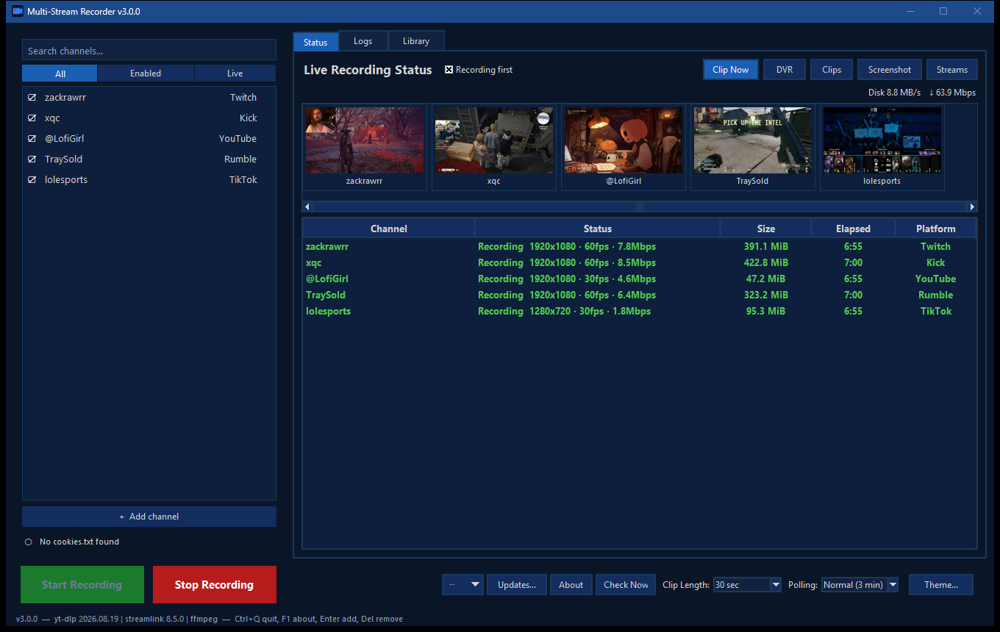
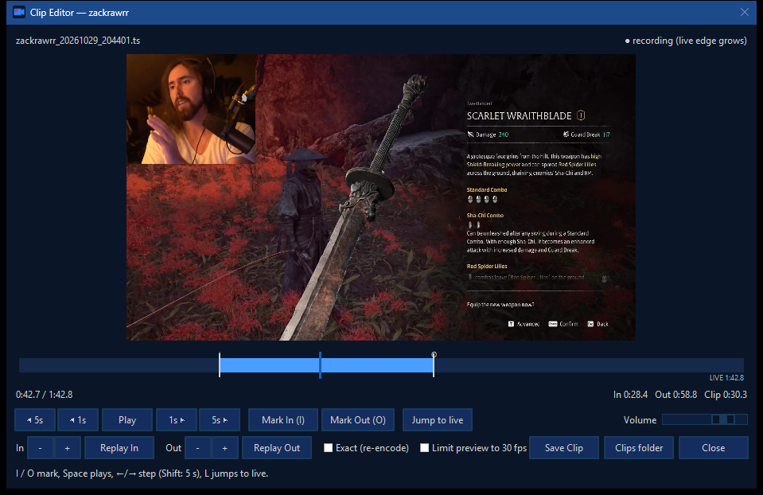
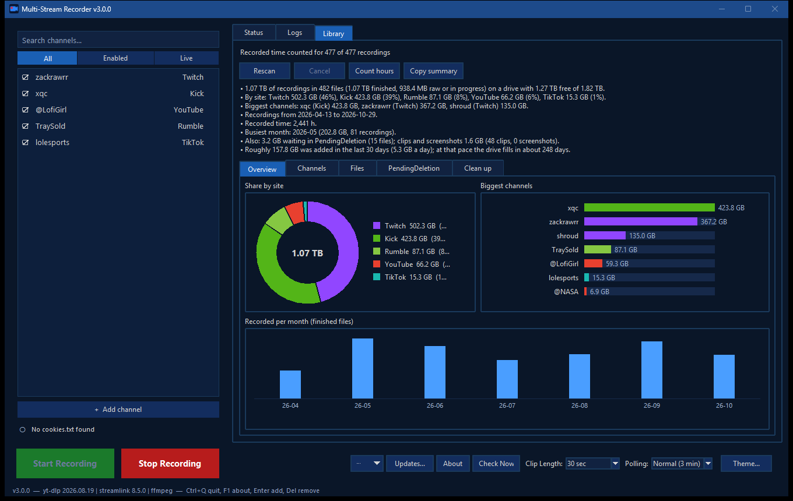
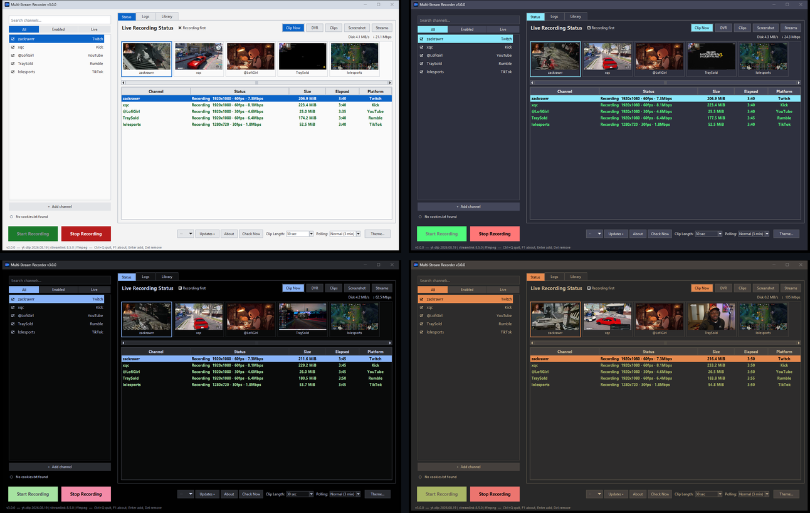

# Multi-Stream Recorder

A Windows-first desktop app (Python + Tkinter) that watches a list of live channels and records each one automatically when it goes live, producing clean MP4 files. It records many channels at once, each in its own worker process, and you can cut clips while a stream is still recording.

Supported: **Kick**, **Twitch**, **YouTube**, **Rumble**, **TikTok**, and custom URLs (any site yt-dlp supports, or a direct `.m3u8`).

This README describes **v3.0.0**. Full history: [CHANGELOG.md](CHANGELOG.md).



<details><summary>More screenshots</summary>

**Clip Editor (DVR)**: In/Out marks on a stream that is still recording.



**Library**: space and hours per site, channel and month.



**Logs**: live log with filter and level drop-down.


**Themes**: Light, Dracula, Catppuccin Mocha OLED and Gruvbox Material (16 built in).



</details>

## What's new in 3.0

- **Clip Editor**: a DVR-style editor with a timeline, sound and a volume slider, smooth preview up to 60 fps, In/Out marks and lossless or frame-exact clips, also while the stream is still recording.
- **Library tab**: see how much space recordings take per site, channel and month, and clean up safely (reversible by default).
- **Agent and headless control**: `msr_ctl.py` and a local, token-protected control channel can do everything the window does, for scripts, bots and AI agents. See [docs/AGENT_GUIDE.md](docs/AGENT_GUIDE.md).
- **Easy install**: double-click `run_msr.pyw`. MSR sets up its own Python environment (`.venv`) on first launch, so it never changes the Python other programs use.
- **Updates dialog**: check and update yt-dlp, streamlink and the other packages from inside the app, with automatic rollback.
- **16 themes** with a live preview, your own theme files, and an app icon with its own taskbar entry.
- **Safer recording**: recording starts at once after a crash, keeps going in a fallback folder when the recordings drive disappears, verifies every remux before touching the original, and no console windows flash.
- **Privacy**: stream URLs, tokens and passwords are redacted from logs, status files and settings history.

## Features

**Roster (left panel)**
- Channels are grouped automatically: **Recording**, **Watching** (enabled, waiting for a stream), and **Off** (disabled).
- Search box and an **All / Enabled / Live** filter. Live shows every channel that is live right now, including Off channels.
- **+ Add channel**: paste a name, `platform:name` or a full URL; the platform is detected for you.
- Right-click menu: start/stop, Check Now, Clip Editor, open in browser, open clips folder, copy, sort, move, remove.
- An amber badge marks a row when that site needs cookies you don't have, or yours expired or were rejected.

**Recording**
- Automatic live detection with jittered polling (default 3 min) and back-off on errors only. The first check runs as soon as you start.
- **Kick realtime push**: one WebSocket to Kick's realtime service wakes a recorder within seconds of go-live; polling keeps running underneath.
- **Presence for Off channels**: Off channels are never recorded, but MSR still learns whether they are live, so the Live filter is accurate.
- **Reconnect grace**: after a stream drops MSR polls every 15 s for 3 minutes, then every 30 s for 10 more, so a short disconnect becomes a new file instead of a missed stream.
- Splits by size (default 8 GB) and length (`max_record_hours`, default 12) with a few seconds of overlap, and on mid-stream resolution changes.
- Raw `.ts` is remuxed to `.mp4` (`+faststart`) with a JSON metadata sidecar. The MP4 is checked before the `.ts` is moved away; a failed remux keeps the `.ts` and retries.
- **Drive loss**: if the recordings drive disappears (USB unplugged, share dropped), recording continues in a fallback folder and is moved back when the drive returns.
- After a crash, recording starts immediately and leftover `.ts` files are remuxed in the background.

**Status tab**
- Per-channel status with measured resolution, fps and bitrate; disk write and network meters.
- Live preview strip of every recording; click a tile to select, double-click to pin a larger preview. A stale preview shows its age.
- The button row, left to right: **Clip Now** (last N seconds, stream copy), **DVR** (open the Clip Editor to scrub back through the recording and cut a clip), **Clips** (the selected channel's clips folder), **Screenshot** and **Streams** (the recordings folder). None of them interrupts the recording.

**Clip Editor**
- Open it with the **DVR** button next to Clip Now (or Shift+click Clip Now), **right-click a channel > Clip Editor…**, or **Library > Files > right-click > Clip Editor…** for any finished recording.
- A timeline over the whole recording so far, with **Jump to live** while it is still recording. Click or drag to scrub; a far jump shows the nearest keyframe at once, then the exact frame.
- **Play with sound** and a **Volume** slider, so you can cut on dialogue. Playback runs at the recording's frame rate up to 60 fps; tick **Limit preview to 30 fps** on slower PCs (remembered).
- **Mark In / Mark Out** (I / O keys), nudge buttons, **Replay In / Out** and the clip length.
- **Save Clip** makes a lossless stream copy starting at the keyframe at or before your In point (it tells you the real start). Tick **Exact (re-encode)** for frame-exact edges. Clips never overwrite each other.
- The editor only reads the file, so the recording keeps going. Nothing extra to install: it uses ffmpeg and Windows' own audio output.

**Library tab**
- How much space your recordings take: total, per site (donut), top channels (bars), per month, and a sortable channel table with **Open folder**. **Copy summary** gives plain text; **Count hours** (optional) adds recorded time. The scan runs in the background, only reads sizes and can be cancelled.
- **Clean up from the tab**: click a slice, bar or month to drill in, select channels and press **Delete...**. You always get a preview with files, sizes and dates first, with filters (older than N days, keep the newest N files or GB, date range).
  - The default is **Move to PendingDeletion**: reversible (**Undo**, or **Restore** in the PendingDeletion tab). MSR deletes those files after `auto_purge_days`. **Delete permanently** needs you to type a confirmation; the Recycle Bin is offered when it is large enough.
  - **Files** lists single files (search, sort, Play, Show in Explorer, Clip Editor, delete). **PendingDeletion** shows size, age and the next purge. **Clean up** suggests large, old, duplicate and leftover files, with nothing ticked until you choose.
  - MSR never touches a channel that is recording, files changed in the last 10 minutes, or anything outside the Processed / Recorded / PendingDeletion / Clips folders. Every action is logged to `library_actions.log`.

**Logs tab**
- Follows new lines only while you are at the bottom (a **New lines** button appears when you scroll back), filter box, level drop-down, highlighting, coloured warnings and errors, Ctrl+F, **Open log file**.

**Look and housekeeping**
- **Themes**: the **Theme...** button opens a list with a live preview: PowerShell Blue (default), Neutral Dark, Light, High Contrast, Midnight Purple, Paper, plus ten based on [Omarchy](https://omarchy.org/themes/) palettes (Arc Blueberry, Catppuccin Mocha OLED, Rose Pine, Gruvbox Material, Dracula, Flexoki Dark, Vesper, Tokyo Night OLED, Tokyo Day, Solarized Light; credits in [THIRD_PARTY_NOTICES.md](THIRD_PARTY_NOTICES.md)). Add your own as `themes/*.json` in the data folder.
- **App icon** and its own taskbar entry; the tray icon shows a red dot while recording.
- Windows remember their size and place and can be dragged by their background.
- **Restore previous...** (the `...` button beside About): the last 20 versions of `channels.json` and `config.ini`, with passwords never stored in the copies.
- One instance per recordings folder; a second launch focuses the existing window.
- `stream_recorder.log` rotates (default 20 MB, 3 backups). Stream URLs, tokens and cookie headers are redacted everywhere.
- No console windows: every ffmpeg, yt-dlp and streamlink process runs hidden.

## Requirements

| Dependency | Needed | Purpose |
| --- | --- | --- |
| Python 3.10+ (3.12 tested) | Yes | Runtime. Windows/macOS installers include Tkinter; Linux needs `python3-tk` (and `python3-venv` on Debian/Ubuntu). |
| ffmpeg + ffprobe on PATH | Yes | Remux, previews, clips, Clip Editor, some HLS recording |
| Deno | Recommended | yt-dlp uses it for YouTube's JS challenge; without it YouTube drops every ~15 s |
| Python packages | Installed for you | yt-dlp, streamlink, curl_cffi, websocket-client, psutil, pystray, Pillow, plyer, colorama (see `requirements.txt`) |

## Install (Windows)

1. Install Python from [python.org](https://www.python.org/downloads/) (tick **Add python.exe to PATH**).
2. Install ffmpeg and (recommended) Deno:
   ```
   winget install Gyan.FFmpeg
   winget install DenoLand.Deno
   ```
3. Get MSR: download the release ZIP from GitHub and unzip it, or
   ```
   git clone https://github.com/ManletPride/Multi-Stream-Recorder.git
   ```
4. Double-click **`run_msr.pyw`** in the MSR folder.

The first launch shows a small "first-time setup" window for about a minute while MSR creates its own environment (`.venv` in the MSR folder) and installs its packages there. Later launches start straight away. MSR writes `config.ini` on first start; recordings go to `%USERPROFILE%\Videos\Multi-Stream Recorder` unless you set `streams_dir`.

Want a desktop shortcut with the icon? Run `python create_shortcut.py` once (`--data-dir D:\msr-data` for another data folder). It never replaces an existing shortcut; `--set-icon "path\to\Old.lnk"` only gives an existing one the icon.

**Linux/macOS:** install ffmpeg and Tk from your package manager (`sudo apt install ffmpeg python3-tk python3-venv`, `brew install ffmpeg`), then run `python3 run_msr.pyw`. The environment is `.venv/bin/python`. `python3 create_shortcut.py --linux > ~/.local/share/applications/multi-stream-recorder.desktop` adds a menu entry.

### MSR's own environment (.venv)

MSR keeps its packages in `.venv` inside the MSR folder, so updating them never changes the Python other programs on your computer use.

- `run_msr.pyw`, `run_msr.bat` and shortcuts made by `create_shortcut.py` create `.venv` on first launch and use it afterwards.
- If setup fails (offline, Python without the `venv` module, no write access), MSR still starts on the Python that opened it, says why (window, log and `msr_venv_error.txt`) and tries again next launch.
- A damaged or half-built `.venv`, one whose Python was uninstalled, or one in a folder that was moved is rebuilt automatically. When `requirements.txt` changes (after an update) the packages are installed again on the next launch.
- Manage your own environment instead: set `MSR_NO_VENV=1`, or `[Advanced] use_venv = false` in `config.ini`, or set `MSR_PYTHON` in `run_msr.local.bat`.
- By hand: `py -3.12 -m venv .venv`, `.venv\Scripts\python -m pip install -r requirements.txt`, `.venv\Scripts\pythonw Multi-Stream-Recorder.py`.

### Where settings live

By default `config.ini`, `channels.json`, `cookies.txt` and window state are in the MSR folder. To keep them elsewhere (the folder must exist):

- `Multi-Stream-Recorder.py --data-dir D:\MSR`, or
- set `MSR_DATA` (read by `run_msr.pyw` / `run_msr.bat`), e.g. `setx MSR_DATA "D:\MSR"`, or `MSR_HOME` (read by the app and `msr_ctl.py`).

For per-machine launcher settings, create an untracked `run_msr.local.bat` next to `run_msr.bat`, for example `set "MSR_DATA=D:\MSR"`.

### Updating

- **MSR itself:** click **vX available** in the status bar (or Updates… > Multi-Stream Recorder). It downloads the release, keeps a backup of the current program files, verifies every file and rolls back if anything fails, then restarts. Your config, cookies, channels and recordings are not touched.
- **yt-dlp, streamlink and packages:** see [Updating yt-dlp, streamlink and packages](#updating-yt-dlp-streamlink-and-packages).
- **From git:** `git pull`, then relaunch (fully quit first; a running MSR does not reload its code). The launcher refreshes `.venv` when `requirements.txt` changed.

## Adding channels

Use **+ Add channel**. Accepted forms:

| Platform | Example |
| --- | --- |
| Kick | `gmhikaru`, `kick:gmhikaru` or `https://kick.com/gmhikaru` |
| Twitch | `twitch:chess` or a twitch.tv URL |
| YouTube | `youtube:@LofiGirl`, a channel ID, or a watch URL |
| Rumble | `rumble:NewsmaxTV` or a rumble.com channel URL |
| TikTok | `tiktok:qvc` (with or without `@`) |
| Fishtank | `fishtank:director` or a raw stream id |
| Custom | any URL yt-dlp supports, or an `.m3u8` |

**Other sources:** Fishtank.live support is built in, but the show is between seasons and has no live cameras right now. Its camera list changes every season, so it may need an update when a new one starts. Details: [docs/fishtank.md](docs/fishtank.md).

Tick a channel to enable it (Watching), untick to put it in Off. Press **Start Recording** to begin the session; channels added while recording start at once.

## Cookies

Cookies are optional for most public streams. They help with YouTube throttling and are needed for subscriber-only or age-gated streams, TikTok (often), and Fishtank if you don't use a login.

1. Install a cookies.txt exporter such as [Get cookies.txt LOCALLY](https://chromewebstore.google.com/detail/get-cookiestxt-locally/cclelndahbckbenkjhflpdbgdldlbecc).
2. Log in to the sites in your browser and export **one combined** `cookies.txt`.
3. Put it in your data folder or streams folder, or set `cookies_file` in `config.ini`.

The indicator under the roster shows whether cookies were found and when auth cookies expire. MSR never logs in for you or refreshes the file. Treat `cookies.txt` like a password.

**Fishtank** can instead use a free account in `config.ini`:
```ini
[Fishtank]
email = you@example.com
password = ...
```
Or leave the password out and set the `MSR_FISHTANK_PASSWORD` environment variable. Camera names, season aliases and stream ids: [docs/fishtank.md](docs/fishtank.md).

## Configuration

`config.ini` is created on first run. The settings people usually change:

| Section / key | Default | Meaning |
| --- | --- | --- |
| `Paths/streams_dir` | Videos\Multi-Stream Recorder | Where `Recorded`, `Processed`, `Clips` and the log go |
| `Paths/fallback_dir` | (blank) | Where recording continues if `streams_dir` becomes unreachable. Blank = a folder in the system temp folder; `off` = pause instead. Moved back when the drive returns |
| `Paths/cookies_file` | auto | Explicit cookies.txt path |
| `Recording/quality` | best | Stream quality |
| `Recording/max_file_size_gb` | 8 | Size split (0 = off) |
| `Recording/max_record_hours` | 12 | Length split (0 = off) |
| `Recording/min_disk_space_gb` | 5 | Low-space threshold for the recordings and fallback drives (status, health) |
| `Recording/filename_pattern` | `{username}_{timestamp}` | Tokens: `{username} {platform} {date} {time} {timestamp} {title}` |
| `Timeouts/poll_interval_minutes` | 3 | Offline check interval (also in the Polling menu) |
| `Timeouts/reconnect_grace_minutes`, `reconnect_extended_minutes` | 3, 10 | 15 s polling after a drop, then 30 s polling |
| `Cleanup/auto_purge_days` | 7 | Days before PendingDeletion is emptied |
| `Cleanup/max_log_size_mb`, `log_backup_count` | 20, 3 | Log rotation |
| `Clipping/clip_length_seconds`, `clips_dir`, `screenshot_format` | 30, (Clips), jpg | Clip Now / Screenshot |
| `Advanced/ffmpeg_path` | ffmpeg | ffmpeg to use if it is not on PATH |
| `Advanced/use_venv` | true | `false` = don't create or use `.venv` |
| `Advanced/verbose` | false | Very noisy; only for diagnosing a failure |
| `Updates/daily_check` | true | Daily background check for package updates |
| `Control/enabled` | true | Local control channel for `msr_ctl.py` |
| `Library/extra_dirs` | (blank) | More folders for the Library tab |
| `GUI/theme` | PowerShell Blue | Colour theme (set from the **Theme...** button) |
| `GUI/minimize_to_tray`, `notifications` | true | UI |

Output layout: `streams_dir\Recorded\<platform>\<channel>\` (raw `.ts` while recording), `Processed\...` (final `.mp4`), `Clips\...`, `PendingDeletion\` (originals, purged after `auto_purge_days`).

## Command line

```
Multi-Stream-Recorder.py [--data-dir DIR] [--config FILE] [--headless] [--json [--library]] [--version]
```

- `--headless` records the enabled channels with no window; Ctrl+C stops cleanly. It keeps running with no channel enabled and waits for commands from `msr_ctl.py`.
- `--json` prints a read-only status snapshot (settings, roster, tools, problems; no secrets) and exits; `--library` adds the Library numbers.

Run these with the environment's Python: `.venv\Scripts\python Multi-Stream-Recorder.py --headless` (Linux: `.venv/bin/python`).

## Agent control (scripts, bots, headless)

Everything you do in the window can be done without it. A running copy (window or `--headless`) accepts commands on a local control channel, and `msr_ctl.py` is the command-line client. With nothing running, `msr_ctl.py` edits `channels.json` / `config.ini` directly.

- **Start here:** [docs/AGENT_GUIDE.md](docs/AGENT_GUIDE.md). `python msr_ctl.py help --json` lists every command with its arguments, safety level and an example.
- **Local only:** `127.0.0.1` on a random port, with a random token in `msr_control.json` in the data folder (removed when MSR quits). Turn it off with `[Control] enabled = false` or `MSR_CONTROL=0`.
- **Live status:** `msr_status.json` in the data folder (every 3 s): channels, recordings, errors, health (tools, disk space, cookie expiry), with no passwords, cookie values or tokens.
- `msr_ctl.py` runs with any Python 3.10+; `deps` commands switch to `.venv` by themselves. Add `--json` for machine-readable output.

```
python msr_ctl.py status                      # what is recording, sizes, errors
python msr_ctl.py add kick:knut twitch:someone youtube:@someone
python msr_ctl.py enable "#3"                 # or disable NAME, enable --all
python msr_ctl.py start | stop | quit
python msr_ctl.py record-start NAME           # or record-stop NAME
python msr_ctl.py clip NAME --seconds 30      # Clip Now
python msr_ctl.py clip NAME --from=-1:00 --to end
python msr_ctl.py clip --file "D:\...\x.mp4" --from 1:02:03 --to 1:02:48 --exact
python msr_ctl.py wait --event finished --channel NAME --timeout 3600
python msr_ctl.py health
python msr_ctl.py recordings --since 24h
python msr_ctl.py library suggest --free 200 --older-days 90
python msr_ctl.py config set Timeouts.poll_interval_minutes 1
python msr_ctl.py deps check                  # package versions; deps update NAME | --all
python msr_ctl.py update install --yes        # update MSR (headless too)
```

Anything that removes or replaces something needs `--yes`. Exit codes: `0` ok, `1` refused or failed, `2` usage, `3` not running, `4` wrong token, `5` needs confirmation, `6` timed out, `7` API version mismatch, `130` Ctrl+C. The protocol is in [AGENTS.md](AGENTS.md); the full command list in `help --json`.

To try it next to a copy you already use, give the second one its own data folder and `streams_dir` (PowerShell):

```powershell
$t = "$env:TEMP\msr-try"
New-Item -ItemType Directory -Force "$t\data", "$t\streams" | Out-Null
Set-Content "$t\data\config.ini" "[Paths]`nstreams_dir = $t\streams" -Encoding utf8
.venv\Scripts\python Multi-Stream-Recorder.py --headless --data-dir "$t\data"   # window 1
python msr_ctl.py --data-dir "$t\data" add kick:knut                            # window 2
python msr_ctl.py --data-dir "$t\data" status
python msr_ctl.py --data-dir "$t\data" quit
```

## Updating yt-dlp, streamlink and packages

Click the version text at the bottom left, or **Updates…** next to About. The dialog lists MSR, yt-dlp, streamlink, ffmpeg and the Python packages with the installed version, the latest version and a status. **Check now** asks PyPI and GitHub; **Update selected** / **Update all** update in the background.

- Running recordings keep the version they started with; the next recording uses the new one.
- If an update fails, the previous version is put back. Offline and permission problems are explained.
- Updates only go into MSR's `.venv`. On a system Python they are refused, so other programs are never affected.
- ffmpeg is shown with its version and source, but MSR doesn't update it (it didn't install it).
- Once a day, in the background, MSR checks for updates and shows **Updates •** when there are some. Turn it off in the dialog or with `[Updates] daily_check = false`.

## Troubleshooting

- **First launch stays on "first-time setup" or says it could not set up .venv**: check your internet connection; details are in `msr_venv_error.txt` in the MSR folder. MSR retries at the next launch. On Debian/Ubuntu install `python3-venv`.
- **"yt-dlp/streamlink not available" in the log**: open **Updates…** and check the rows; the log's `Environment:` line shows which Python MSR runs on.
- **ffmpeg not found**: install it and sign out/in (or reboot) so PATH updates, or set `Advanced/ffmpeg_path`.
- **YouTube drops every ~15 s**: install Deno. **"No video formats found!"**: leave `youtube_player_client` blank and update yt-dlp in **Updates…**.
- **Kick 403 / not recording**: update streamlink in **Updates…**, and delete any old third-party `kick.py` in `%APPDATA%\streamlink\plugins\`.
- **Kick push not listening** (no `push: listening` in the status column): check that websocket-client and curl_cffi are installed (Updates…). Recording still works through polling.
- **TikTok live but shown offline**: MSR cross-checks TikTok's own API; if neither detects it, re-export TikTok cookies (`msToken`, `ttwid`).
- **Rumble 403**: update yt-dlp and curl_cffi. Public channels need no login.
- **Fishtank "could not obtain JWT"**: add `[Fishtank]` email/password or fresh fishtank cookies.
- **MSR does not open**: look for `msr_startup_error.log` in the data folder, or run `.venv\Scripts\python Multi-Stream-Recorder.py` from a terminal to see the error.
- **Leftover `.ts` in Recorded** after a crash: remuxed automatically in the background on the next start. By hand: `ffmpeg -i in.ts -c copy -movflags +faststart out.mp4`.
- **Changes don't show up**: fully quit (Ctrl+Q) and relaunch.

## Development

```
python -m unittest discover -s tests -t .
```

Code lives in `msr/`; `Multi-Stream-Recorder.py` is the entry point and `run_msr.pyw` the launcher. See [AGENTS.md](AGENTS.md) for the layout, design notes and gotchas, and [llms.txt](llms.txt) for a manual aimed at AI assistants.

## Legal and acceptable use

For personal archival of streams you are allowed to record. Follow each site's terms of service and your local law; don't redistribute others' streams. Some custom-URL sites are adult; never record content involving minors. See [SECURITY.md](SECURITY.md) for vulnerability reports and what MSR stores on disk.

## Author and license

Created by ManletPride, built with assistance from Claude (Anthropic) and Grok (xAI). MIT License, see [LICENSE](LICENSE).
