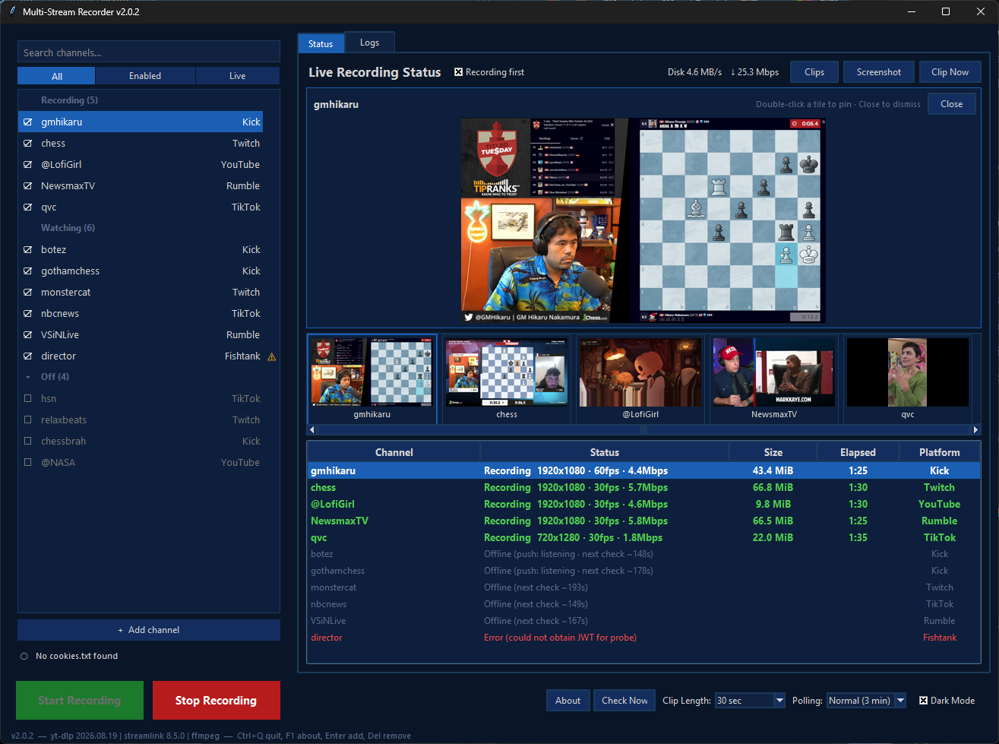
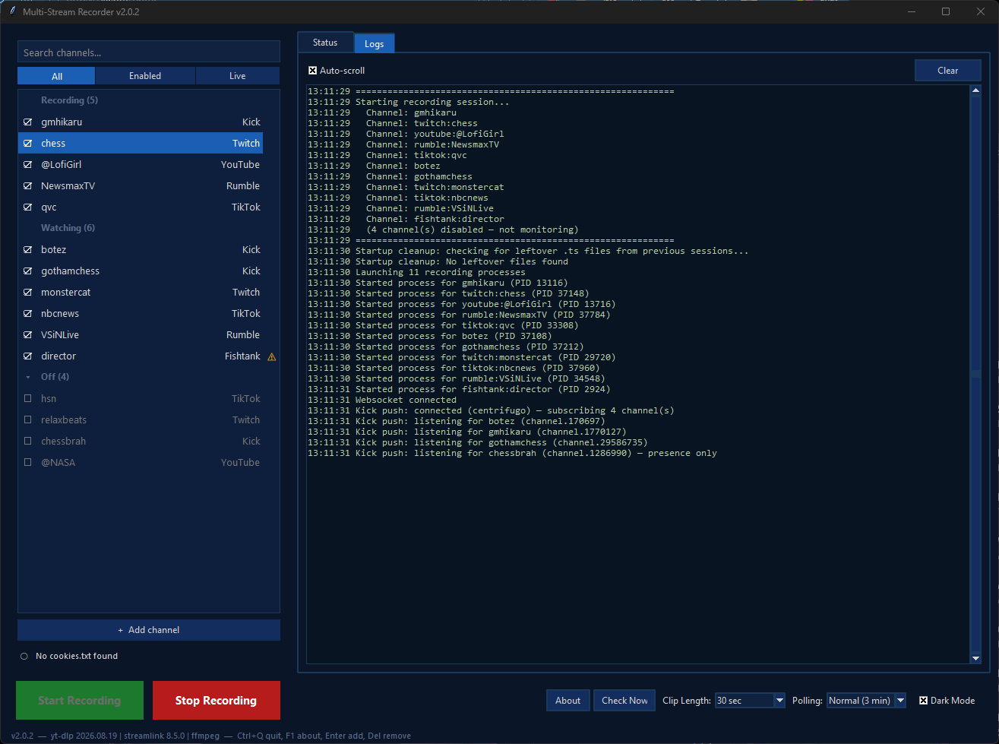

# Multi-Stream Recorder

A Windows-first desktop app (Python + Tkinter) that watches a list of live channels and records each one automatically when it goes live, producing clean MP4 files. It runs many channels at once, each in its own worker process.

Supported: **Kick**, **Twitch**, **YouTube**, **Rumble**, **TikTok**, **Fishtank.live**, and custom URLs (any site yt-dlp supports, or a direct `.m3u8`).

This is **v2.1.0**. See [CHANGELOG.md](CHANGELOG.md).



## Features

**Roster (left panel)**
- Channels are grouped automatically: **Recording**, **Watching** (enabled, waiting for a stream), and **Off** (disabled).
- Search box and an **All / Enabled / Live** filter. Live shows every channel that is live right now, including Off channels.
- **+ Add channel** dialog: paste a name, `platform:name`, or a full URL; the platform is detected for you.
- Right-click menu: start/stop, Check Now, open in browser, open clips folder, copy, sort, move to top/bottom, remove.
- An amber warning badge appears on a row when that site needs cookies you don't have, or your cookies for it have expired or were rejected.

**Recording**
- Automatic live detection with jittered polling (default 3 min) and exponential backoff on errors only.
- **Kick realtime push**: one WebSocket to Kick's own realtime service (Centrifugo, negotiated the same way kick.com does) wakes a worker within seconds of go-live. Polling keeps running underneath as a fallback.
- **Presence for Off channels**: Off channels are never recorded, but MSR still learns whether they are live (Kick push, plus a slow ~10 min check for other platforms), so the Live filter is accurate.
- **Reconnect grace**: after a stream drops, MSR polls every 15 s for 3 minutes, then every 30 s for 10 more, so short streamer disconnects become a new file instead of a missed stream.
- Size split (default 8 GB) with a few seconds of overlap, and a split on mid-stream resolution changes.
- Raw `.ts` is remuxed to `.mp4` (`+faststart`) with a JSON metadata sidecar; finished files without audio are flagged in the log.

**Status tab**
- Per-channel status with measured resolution, fps and bitrate.
- Live preview strip of every recording; click a tile to select, double-click to pin a larger preview.
- **Clip Now** (last N seconds, stream copy, keyframe-aligned) and **Screenshot**, without interrupting the recording.
- **Clip Editor**: Shift+click Clip Now (or right-click a channel, or a file in Library > Files) to scrub the recording so far, listen with a volume slider, mark In/Out and save a clip, while it keeps recording.
- **Clips** and **Streams** buttons open the clips folder of the selected channel and the recordings folder.
- Disk write and network meters.

**Library tab**
- How much space your recordings take: total, per site (donut), top channels (bars), per month, and a sortable channel table with **Open folder**. **Copy summary** gives plain text for pasting. **Count hours** (optional) adds recorded time.
- The scan only reads folder listings and file sizes in a background thread (Cancel any time). `--json --library` prints the same numbers for scripts.
- **Clean up from the tab.** Click a donut slice to list a site's channels, a bar to select a channel, a month to list its files. Select channels and press **Delete...** (or right-click, or the Delete key). You always get a preview with the files, sizes and dates first, and you can untick files or filter (older than N days, keep the newest N files / N GB, a date range).
  - The default is **Move to PendingDeletion**: reversible (an **Undo** button appears, and the **PendingDeletion** tab has **Restore**), and MSR deletes those files itself after the PendingDeletion delay, when it next starts. **Delete permanently** needs you to type the channel name or `DELETE`. The Recycle Bin is offered only when Windows reports a bin big enough.
  - The **Files** tab lists single files (search, sort, Play, Show in Explorer, delete). The **PendingDeletion** tab shows size, age and the next purge, with **Empty now** and **Restore**. **Clean up** suggests the largest files, the oldest, channels not in your roster, leftover raw files, duplicates and empty folders, with nothing ticked until you choose.
  - MSR never touches a channel that is recording, files changed in the last 10 minutes, or anything outside the Processed / Recorded / PendingDeletion / Clips folders. Every action is written to `library_actions.log` in the data folder.

**Logs tab**
- Follows new lines only while you are at the bottom (a **New lines** button appears when you scrolled back), filter box and level drop-down, search highlighting, coloured warnings/errors, Ctrl+F, **Open log file**.

**Housekeeping**
- **Themes**: the **Theme...** button (bottom bar) opens a list with a live preview: PowerShell Blue (default), Neutral Dark, Light, High Contrast, Midnight Purple, Paper, plus ten more drawn from [Omarchy](https://omarchy.org/themes/) theme palettes (dark: Arc Blueberry, Catppuccin Mocha OLED, Rose Pine, Gruvbox Material, Dracula, Flexoki Dark, Vesper, Tokyo Night OLED; light: Tokyo Day, Solarized Light; credits and licences in [THIRD_PARTY_NOTICES.md](THIRD_PARTY_NOTICES.md)). Popups, charts and the Windows title bar follow. Add your own as `themes/*.json` in the data folder (the window can open the folder and writes a sample). Windows remember their size and place and can be dragged by their background.
- **Restore previous...** (the `...` button beside About): the last 20 versions of `channels.json` and `config.ini`, with passwords masked in the list.
- One instance per recordings folder; a second launch focuses the existing window.
- `stream_recorder.log` rotates at a size limit (default 20 MB, 3 backups). Stream URLs, tokens and cookie headers are redacted from the log.
- `--data-dir` / `MSR_HOME` keep config, cookies and channel list outside the code folder.
- `run_msr.pyw` / `run_msr.bat` start the app with no console window.
- In-app update from GitHub releases (status bar shows **vX available**).
- `--headless` mode for running without a window.



## Requirements

| Dependency | Needed | Purpose |
| --- | --- | --- |
| Python 3.10+ (3.12 tested) | Yes | Runtime. Windows/macOS installers include Tkinter; Linux needs `python3-tk`. |
| ffmpeg + ffprobe on PATH | Yes | Remux, previews, clips, stream info, some HLS recording |
| yt-dlp (`[default]` extra) | Yes | YouTube, Rumble, TikTok detection; custom URLs |
| streamlink 8+ | Yes | Kick and Twitch (built-in Kick Cloudflare solver), TikTok recording |
| Deno | Recommended | yt-dlp uses it for YouTube's JS challenge; without it YouTube drops every ~15 s |
| psutil, curl_cffi, websocket-client | Recommended | Process cleanup and meters; Rumble/Fishtank/Kick HTTP; Kick realtime push |
| pystray + Pillow, plyer, colorama | Optional | Tray icon, notifications, colored console |

All Python packages are in `requirements.txt`.

## Install (Windows)

These steps were tested on a clean clone with Python 3.12.

1. Install Python from [python.org](https://www.python.org/downloads/) (tick **Add python.exe to PATH**).
2. Install ffmpeg and (recommended) Deno, then open a new terminal and check:
   ```
   winget install Gyan.FFmpeg
   winget install DenoLand.Deno
   ffmpeg -version
   deno --version
   ```
3. Get the code and install the packages into a virtual environment:
   ```
   git clone https://github.com/ManletPride/Multi-Stream-Recorder.git
   cd Multi-Stream-Recorder
   py -3.12 -m venv .venv
   .venv\Scripts\python -m pip install -r requirements.txt
   ```
4. Run it:
   ```
   .venv\Scripts\python Multi-Stream-Recorder.py
   ```
   or double-click `run_msr.pyw` / `run_msr.bat` (they use `.venv` automatically when it exists).

You don't need to activate the venv: MSR puts its own interpreter's `Scripts` folder first on PATH, so it finds the yt-dlp and streamlink installed there.

On first launch MSR writes `config.ini`. Recordings go to `%USERPROFILE%\Videos\Multi-Stream Recorder` unless you set `streams_dir`.

Linux/macOS: same steps with `python3 -m venv .venv`, `.venv/bin/python`, and ffmpeg from your package manager (`apt install ffmpeg python3-tk`, `brew install ffmpeg`).

### Where settings live

By default `config.ini`, `channels.json`, `cookies.txt` and window state are in the folder you start MSR from. To keep them elsewhere:

- `python Multi-Stream-Recorder.py --data-dir D:\MSR`, or
- set `MSR_HOME` (used by the app) or `MSR_DATA` (used by `run_msr.bat` / `run_msr.pyw`), e.g. `setx MSR_DATA "D:\MSR"`.

The folder must already exist. For per-machine launcher settings, create an untracked `run_msr.local.bat` next to `run_msr.bat` (it is git-ignored), for example:
```
set "MSR_DATA=D:\MSR"
```

### Updating

From the app: click **vX available** in the status bar. It downloads that release, replaces `Multi-Stream-Recorder.py`, `msr\`, `requirements.txt` and `channels_fishtank.json`, and restarts. Your config, cookies, channels and recordings are not touched. After an update that changes `requirements.txt`, run `pip install -r requirements.txt` again.

From git: `git pull`, then `pip install -r requirements.txt`. Fully quit and relaunch; a running MSR does not reload its code.

## Adding channels

Use **+ Add channel** (or Enter in the dialog). Accepted forms:

| Platform | Example |
| --- | --- |
| Kick | `gmhikaru` or `https://kick.com/gmhikaru` |
| Twitch | `twitch:chess` or a twitch.tv URL |
| YouTube | `youtube:@LofiGirl`, a channel ID, or a watch URL |
| Rumble | `rumble:NewsmaxTV` or a rumble.com channel URL |
| TikTok | `tiktok:qvc` (with or without `@`) |
| Fishtank | `fishtank:director` or a raw stream id |
| Custom | any URL yt-dlp supports, or an `.m3u8` |

Tick a channel to enable it (Watching), untick to put it in Off. Press **Start Recording** to begin the session.

## Cookies

Cookies are optional for most public streams. They help with YouTube throttling and are needed for subscriber-only or age-gated streams, TikTok (often), and Fishtank if you don't use a login.

1. Install a cookies.txt exporter such as [Get cookies.txt LOCALLY](https://chromewebstore.google.com/detail/get-cookiestxt-locally/cclelndahbckbenkjhflpdbgdldlbecc).
2. Log in to the sites in your browser and export **one combined** `cookies.txt`.
3. Put it in your data folder or streams folder, or set `cookies_file` in `config.ini`.

The indicator under the roster shows whether cookies were found and when auth cookies expire; the amber row badge points at the specific site. MSR never logs in for you or refreshes the file. Treat `cookies.txt` like a password and never commit it.

**Fishtank** can instead use a free account in `config.ini`:
```ini
[Fishtank]
email = you@example.com
password = ...
```
These are stored in plain text, which is one more reason `config.ini` is git-ignored. Camera names, season aliases and stream ids: [docs/fishtank.md](docs/fishtank.md).

## Configuration

`config.ini` is created on first run with comments. The settings people usually change:

| Section / key | Default | Meaning |
| --- | --- | --- |
| `Paths/streams_dir` | Videos\Multi-Stream Recorder | Where `Recorded`, `Processed`, `Clips` and the log go |
| `Paths/fallback_dir` | (blank) | Where recording continues if `streams_dir` becomes unreachable while MSR runs (an unplugged USB or external drive, a dropped share). Blank = `MultiStreamRecorder\Recordings` in the system temp folder; `off` = pause instead. What was recorded there is moved back to `streams_dir` when it returns. It is only used when the folder cannot be reached, not when it is low on space |
| `Paths/cookies_file` | auto | Explicit cookies.txt path |
| `Recording/quality` | best | Stream quality |
| `Recording/max_file_size_gb` | 8 | Size split (0 = off) |
| `Recording/filename_pattern` | `{username}_{timestamp}` | Tokens: `{username} {platform} {date} {time} {timestamp} {title}` |
| `Timeouts/poll_interval_minutes` | 3 | Offline check interval (also set from the Polling menu) |
| `Timeouts/reconnect_grace_minutes` | 3 | 15 s polling after a drop |
| `Timeouts/reconnect_extended_minutes` | 10 | then 30 s polling |
| `Cleanup/max_log_size_mb`, `log_backup_count` | 20, 3 | Log rotation |
| `Clipping/clip_length_seconds`, `screenshot_format` | 30, jpg | Clip Now / Screenshot |
| `Advanced/verbose` | false | Very noisy; only for diagnosing a failure |
| `GUI/theme` | PowerShell Blue | Colour theme (set from the **Theme...** button). Old `GUI/dark_mode` is still read: `true` = PowerShell Blue, `false` = Light |
| `GUI/minimize_to_tray`, `notifications` | true | UI |

Output layout: `streams_dir\Recorded\<platform>\<channel>\` (raw `.ts` while recording), `Processed\...` (final `.mp4`), `Clips\...`, `PendingDeletion\` (originals, purged after `auto_purge_days`).

## Command line

```
python Multi-Stream-Recorder.py [--data-dir DIR] [--config FILE] [--headless] [--json [--library]] [--version]
```

`--headless` records the enabled channels in `channels.json` with no window; Ctrl+C stops cleanly. It keeps running with no channel enabled (waiting for commands) as long as agent control is on.

## Agent control (scripts, bots, headless)

Writing an agent? Start with [docs/AGENT_GUIDE.md](docs/AGENT_GUIDE.md); `python msr_ctl.py help --json` lists every command with its arguments, safety level and an example.

Everything you do in the window can be done without it. A running copy (window or `--headless`) accepts commands on a local control channel, and `msr_ctl.py` is the command-line client. With nothing running, `msr_ctl.py` edits `channels.json` / `config.ini` directly (one atomic write, with the same history copy the app keeps).

- **Local only.** The channel listens on `127.0.0.1` on a random port. Every request must carry the random token that the app writes to `msr_control.json` in the data folder when it starts (git-ignored, removed when it quits). There is no remote access.
- **Live status file.** `msr_status.json` in the data folder is rewritten every 3 seconds and after each command. It lists every channel (enabled, status, live, recording, file name, size, duration, error, Kick push, URL, last error and when, error and restart counts, last live and last recorded times) plus the session, fallback-drive state and background cleanup, the last 20 recordings finished in this run (path, channel, size, duration, finish time, remux OK), the raw files waiting for the cleanup remux, and a `health` block (tools and versions, free space on the main and fallback drives against `min_disk_space_gb`, cookie file validity and earliest login expiry, whether a Fishtank login is set, update available, and a list of problems). It holds no passwords, cookie values or tokens, and custom URLs appear without their query string. Headless also checks disabled channels' live/offline state (as the window does) and looks for an update 10 seconds after start.
- **Turn it off** with `[Control] enabled = false` in `config.ini` or `MSR_CONTROL=0` in the environment.

`msr_ctl.py` finds the data folder from `--data-dir`, then `MSR_HOME`, then `MSR_DATA`, then the current folder. Add `--json` for machine-readable output.

```
python msr_ctl.py status                      # what is recording, sizes, errors
python msr_ctl.py channels
python msr_ctl.py add twitch:someone          # platform:name, a bare Kick name, or a channel URL
python msr_ctl.py add kick:knut youtube:@someone https://www.tiktok.com/@someone
python msr_ctl.py add @someone --platform youtube --disabled
python msr_ctl.py enable "#3" kickname        # #N = position in the list
python msr_ctl.py disable kickname
python msr_ctl.py disable --all               # or enable --all
python msr_ctl.py remove twitch:someone       # recordings on disk are kept
python msr_ctl.py move kickname --to top      # top | bottom | up | down
python msr_ctl.py sort platform               # enabled | platform | name
python msr_ctl.py edit twitch:old --name new
python msr_ctl.py start                       # Start Recording
python msr_ctl.py stop                        # Stop Recording
python msr_ctl.py record-start kickname       # one channel, mid-session
python msr_ctl.py record-stop kickname       # says per channel: stopped_recording or was_idle
python msr_ctl.py check [kickname]            # Check Now
python msr_ctl.py clip kickname --seconds 30  # Clip Now / Screenshot Now
python msr_ctl.py screenshot kickname
python msr_ctl.py config get Timeouts
python msr_ctl.py config set Timeouts.poll_interval_minutes 1
echo secret | python msr_ctl.py config set Fishtank.password --stdin
python msr_ctl.py logs -n 50 --filter error
python msr_ctl.py health                      # tools, disk space, cookies, Fishtank login, problems
python msr_ctl.py recordings --since 24h      # finished .mp4s, newest first (--channel, --limit)
python msr_ctl.py recordings pending          # raw .ts waiting for a remux, files in PendingDeletion
python msr_ctl.py recordings retry            # run the leftover cleanup/remux now
python msr_ctl.py wait --event finished --channel kickname --timeout 3600
python msr_ctl.py events                      # recent live / finished / error events
python msr_ctl.py library summary
python msr_ctl.py library files --channel kickname --older-than-days 30
python msr_ctl.py library plan pending --channel kickname --older-than-days 30
python msr_ctl.py library run pending --channel kickname --older-than-days 30 --yes
python msr_ctl.py library batches             # then: library restore <batch> --yes
python msr_ctl.py library restore --last --yes  # undo the newest move to PendingDeletion
python msr_ctl.py library suggest --free 200 --older-days 90   # read only: what could go
python msr_ctl.py library log -n 20           # library_actions.log
python msr_ctl.py history list channels       # then: history restore channels 2 --yes
python msr_ctl.py update check
python msr_ctl.py update install --yes        # headless too: stops, updates, restarts headless with the same data folder
python msr_ctl.py quit                        # stops recording AND closes MSR (window or headless)
```

**Adding channels.** Write `platform:name` for every site: `kick:knut`, `twitch:asmongold`, `youtube:@name` (or a `UC...` channel id or a video id), `rumble:name`, `tiktok:name`, `fishtank:name`. A bare name is a Kick channel (as in the window), and a full URL works too (`https://kick.com/knut`, `https://www.twitch.tv/name`, `https://www.youtube.com/@name`; any other URL becomes a custom channel). `add kick knut` is refused: that is two words, and `kick` alone is not a channel. If one name in an `add` is wrong, none are added.

**Do I need `start`?** Not after adding a channel. A running copy starts watching (and recording, when it is live) every channel you add or enable, at once:
- `--headless` starts recording the enabled channels when it opens. If it opened with none, the first `add` or `enable` starts the session.
- `stop` stops all recording, and it stays stopped (adds are only saved) until you run `start` or `record-start NAME`.
- In the window, adding a channel while recording starts it at once, as the + Add button does. When the window is not recording, `start` is the Start Recording button.
- With no copy running, commands only change the files (`saved: files (MSR not running)`). Start MSR to record.

**Waiting for something.** `wait` blocks until a channel goes live (`live`), a recording is finished (`finished`, also when its remux failed: see `remux_ok`) or an error is reported (`error`), for one `--channel` or any (it warns when that channel is not recording, since then no `finished` can come soon), and exits `6` after `--timeout` seconds (default 300, at most 3600) with nothing. Each event has a `seq`; pass `--after SEQ` to the next `wait` so nothing that happened in between is missed.

**After a stop.** `record-stop` (or `stop`) leaves the raw `.ts`; the cleanup remuxes it a few seconds later (as soon as the stopped workers are confirmed gone; locked files are retried). Until then the channel shows `finishing` (`waiting_for_cleanup`, then `remuxing`) and the events `stopped`, `remux_started` and `finished` follow. `wait --event finished --channel NAME` after a stop starts at that stop, so it also returns a finish that happened before the wait.

**Update headless.** `update install --yes` downloads the release, stops recording (remuxing what was recorded), quits, lets the update helper copy the new files, and starts the same copy again with `--headless --data-dir <the same data folder>`. The restarted copy runs in the background with no console window; use `msr_ctl.py status` and `logs`.

Anything that removes or replaces something needs `--yes` (a permanent delete needs `--confirm <word>`, the word `library plan permanent ...` shows). Exit codes: `0` ok, `1` refused or failed, `2` usage, `3` not running, `4` wrong token, `5` needs confirmation, `6` timed out, `7` control API version mismatch (use the `msr_ctl.py` next to the running copy), `130` Ctrl+C (no traceback). `msr_control.json`, `ping`, `help --json` and `msr_status.json` carry an `api_version`; it changes only when something is removed or changes meaning. The protocol (one JSON line per request) is in `AGENTS.md`.

To try it next to a copy you already use, give the second one its own data folder with a different `streams_dir`. One copy per recordings folder can run at a time. In PowerShell:

```powershell
cd C:\path\to\Multi-Stream-Recorder
$t = "$env:TEMP\msr-try"
New-Item -ItemType Directory -Force "$t\data", "$t\streams" | Out-Null
Set-Content "$t\data\config.ini" "[Paths]`nstreams_dir = $t\streams" -Encoding utf8
Set-Content "$t\data\channels.json" "[]" -Encoding ascii

# window 1: the recorder (Ctrl+C or 'quit' from window 2 stops it)
python Multi-Stream-Recorder.py --headless --data-dir "$t\data"

# window 2: the controls (set $t again in a new window)
$t = "$env:TEMP\msr-try"
python msr_ctl.py --data-dir "$t\data" add kick:knut twitch:saruei
python msr_ctl.py --data-dir "$t\data" status
python msr_ctl.py --data-dir "$t\data" logs -n 20
python msr_ctl.py --data-dir "$t\data" health
python msr_ctl.py --data-dir "$t\data" wait --event live --timeout 120
python msr_ctl.py --data-dir "$t\data" recordings
python msr_ctl.py --data-dir "$t\data" quit
```

Recordings land in `$t\streams\Recorded` (raw `.ts` while recording) and `$t\streams\Processed` (`.mp4` after the stream ends or MSR stops). Instead of `--data-dir` on every line you can set `$env:MSR_HOME = "$t\data"` once in window 2.

## Troubleshooting

- **"yt-dlp/streamlink not available" in the log**: install `requirements.txt` into the Python you actually launch MSR with. The startup log prints the versions it found.
- **ffmpeg not found**: install it and open a new terminal so PATH updates; or set `Advanced/ffmpeg_path`.
- **YouTube drops every ~15 s**: install Deno. **"No video formats found!"**: leave `youtube_player_client` blank and update yt-dlp (`pip install -U "yt-dlp[default]"`).
- **Kick 403 / not recording**: update streamlink (8+), and delete any old third-party `kick.py` in `%APPDATA%\streamlink\plugins\`.
- **Kick push not listening** (no `push: listening` in the status column): install `websocket-client` and `curl_cffi`. The log shows `Kick push: connected (centrifugo)` and one `listening for <channel>` line per channel when it works; failures are logged about once an hour while MSR keeps retrying. Recording still works through polling.
- **TikTok live but shown offline**: yt-dlp sometimes says "not currently live" for live rooms; MSR cross-checks TikTok's webcast API and logs when it overrides yt-dlp. If neither detects it, re-export TikTok cookies (`msToken`, `ttwid`).
- **Rumble 403**: install `curl_cffi` and update yt-dlp. Public channels need no login.
- **Fishtank "could not obtain JWT"**: add `[Fishtank]` email/password or fresh fishtank cookies.
- **Leftover `.ts` in Recorded** after a crash: they are remuxed on the next start, in the background (recording starts immediately). By hand: `ffmpeg -i in.ts -c copy -movflags +faststart out.mp4`.
- **Changes don't show up**: fully quit (Ctrl+Q) and relaunch.

## Development

```
python -m unittest discover -s tests -t .
```

Code lives in `msr/` (`gui.py`, `channel_panel.py`, `worker.py`, `platforms.py`, `recorder.py`, `kick_realtime.py`, `presence.py`, ...). `Multi-Stream-Recorder.py` is only the launcher. See [AGENTS.md](AGENTS.md) for design notes and gotchas.

## Legal and acceptable use

For personal archival of streams you are allowed to record. Follow each site's terms of service and your local law; don't redistribute others' streams. Some custom-URL sites are adult; never record content involving minors. See [SECURITY.md](SECURITY.md) for vulnerability reports and what MSR stores on disk.

## Author and license

Created by ManletPride, built with assistance from Claude (Anthropic) and Grok (xAI). MIT License, see [LICENSE](LICENSE).
