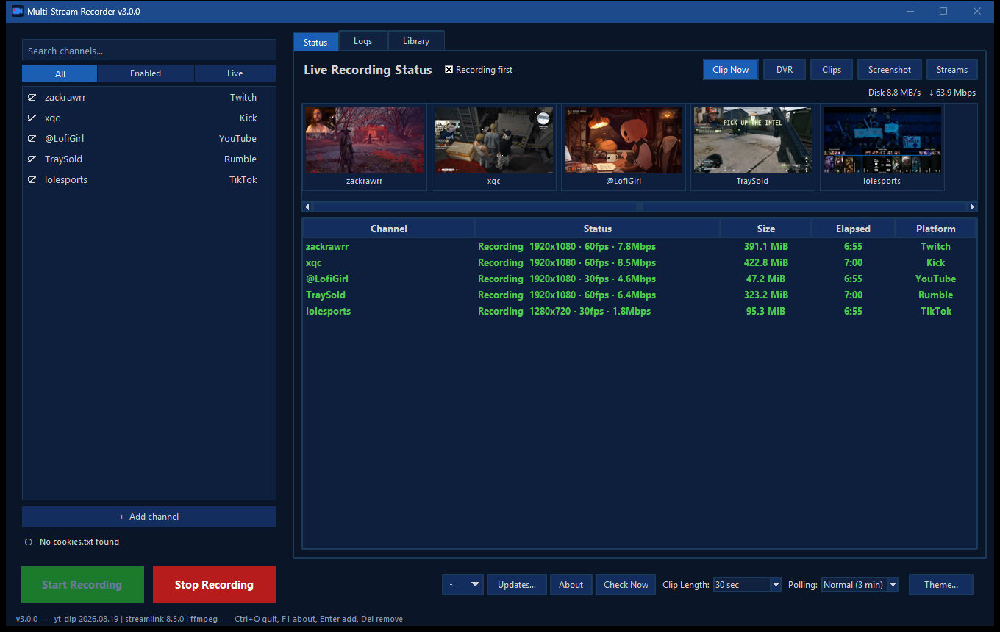
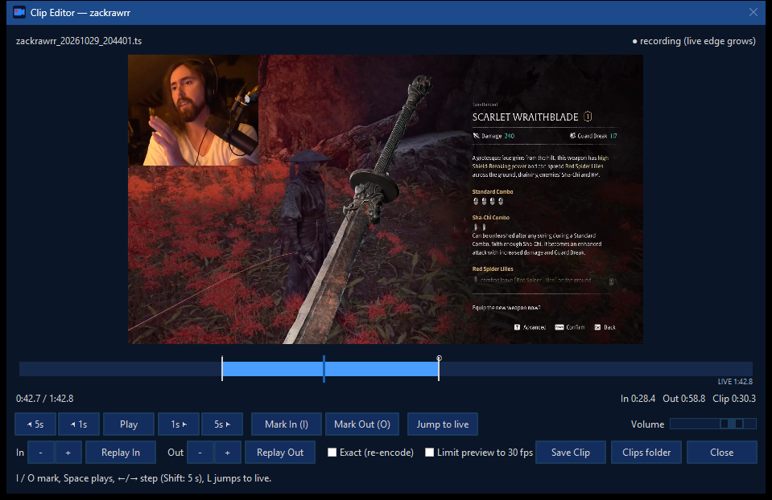
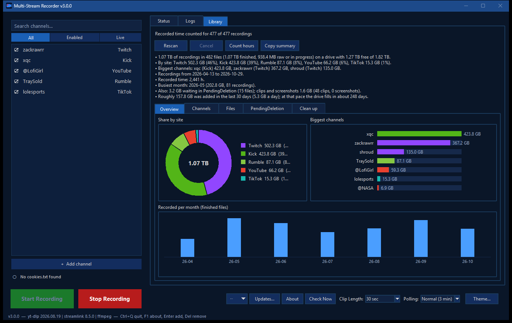
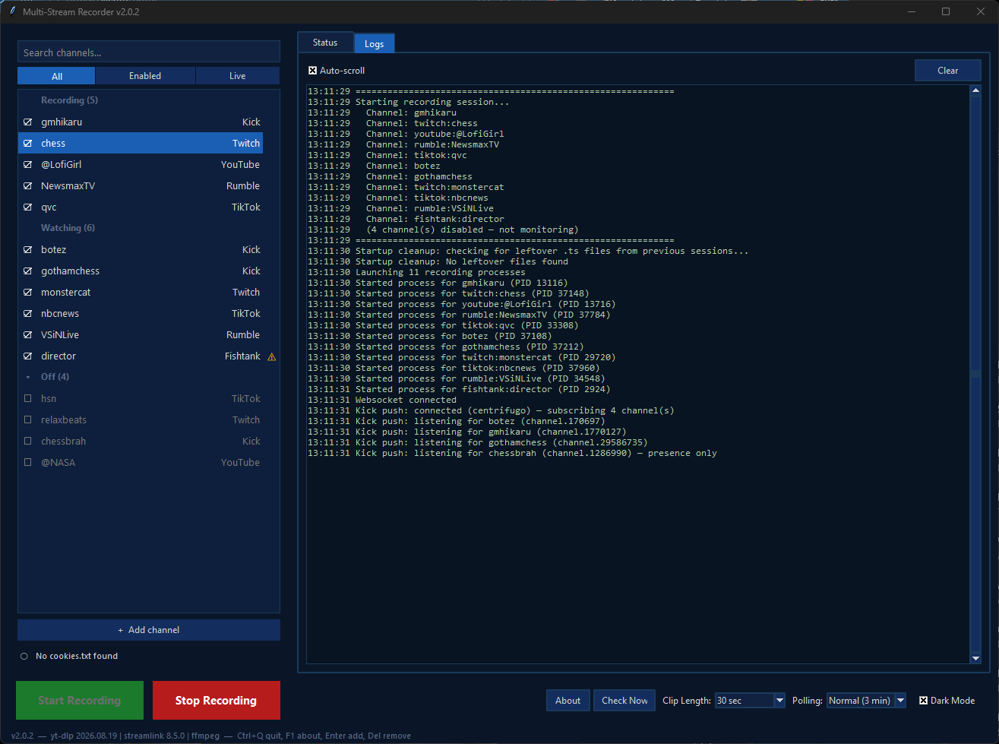
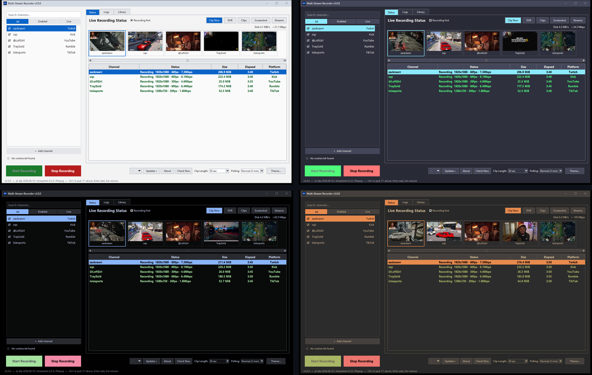

# Multi-Stream Recorder

A Windows-first desktop app (Python + Tkinter, also supporting Linux and macOS) that watches a list of live channels and records each one automatically when it goes live, producing clean MP4 files. Offline channels share a lightweight polling coordinator and each live stream records in its own worker process; you can cut clips while a stream is still recording.

Supported: **Kick**, **Twitch**, **YouTube**, **Rumble**, **TikTok**, and custom URLs (any site yt-dlp supports, or a direct `.m3u8`).

This README describes **v3.3.0**.



<details><summary>More screenshots</summary>

**Clip Editor (DVR)**: In/Out marks on a stream that is still recording.



**Library**: space and hours per site, channel and month.



**Logs**: live log with filter and level drop-down.



**Themes**: Light, Dracula, Catppuccin Mocha OLED and Gruvbox Material (16 built in).



</details>

## What's new in 3.3.0

- **Offline channels share one poller.** They are checked in-process, and a recording worker starts only when a channel goes live. Signed-in Twitch checks are batched (up to 100). Kick uses a light HTTP check before streamlink. When Kick or Twitch push is connected, that fallback check waits at least 10 minutes.
- **A saved secret stays tied to its field.** Linux and macOS still use the 3.2.0 cipher (an HMAC-SHA256 keystream and MAC). The MAC now includes the setting name, so one field's blob cannot be pasted into another. Windows DPAPI takes the same context as optional entropy. A blob from 3.2.0 still opens, and is rewritten in the new form the next time that secret is saved.
- **Quit asks while a stream is recording.** The smallest window is 1060×620 (it was 1060×720) so it fits a 1080p laptop at 150% scaling. If ffmpeg is missing, the Status tab shows a banner with **Open Options**.

Earlier versions: [CHANGELOG.md](CHANGELOG.md) and [docs/release_notes/](docs/release_notes/).

## Install (Windows)

1. Install Python from [python.org](https://www.python.org/downloads/) (tick **Add python.exe to PATH**).
2. Install ffmpeg and (recommended) Deno:
   ```
   winget install Gyan.FFmpeg
   winget install DenoLand.Deno
   ```
3. Get MSR: download the release ZIP from GitHub and unzip it, or
   ```
   git clone https://github.com/ManletPride/Multi-Stream-Recorder.git
   ```
4. Double-click **`run_msr.pyw`** in the MSR folder. **`run_msr.bat`** does the same and tries `pyw -3`, then `pythonw`, `py -3`, and `python`.

The first launch shows a small first-time setup window, with each step and a live log, for about a minute while MSR creates its own environment (`.venv` in the MSR folder) and installs its packages there. Later launches start straight away. MSR writes `config.ini` on first start; recordings go to `%USERPROFILE%\Videos\Multi-Stream Recorder` unless you set `streams_dir`. If ffmpeg is not on PATH, the window still opens and the Status tab shows a banner with **Open Options**.

Want a desktop shortcut with the icon? Run `python create_shortcut.py` once (`--data-dir D:\msr-data` for another data folder). It never replaces an existing shortcut; `--set-icon "path\to\Old.lnk"` only gives an existing one the icon.

**Linux/macOS:** install ffmpeg and Tk from your package manager (`sudo apt install ffmpeg python3-tk python3-venv`, `brew install ffmpeg`), then run `python3 run_msr.pyw`. The environment is `.venv/bin/python`. `python3 create_shortcut.py --linux > ~/.local/share/applications/multi-stream-recorder.desktop` adds a menu entry. On Linux the tray libraries are optional (missing build headers do not block setup) and Hyprland needs a float rule: [docs/linux.md](docs/linux.md).

### MSR's own environment (.venv)

MSR keeps its packages in `.venv` inside the MSR folder, so updating them never changes the Python other programs on your computer use.

- `run_msr.pyw`, `run_msr.bat` and shortcuts made by `create_shortcut.py` create `.venv` on first launch and use it afterwards.
- If setup fails (offline, Python without the `venv` module, no write access), MSR still starts on the Python that opened it, says why (window, log and `msr_venv_error.txt`) and tries again next launch.
- A damaged or half-built `.venv`, one whose Python was uninstalled, or one in a folder that was moved is rebuilt automatically. When `requirements.txt` changes (after an update) the packages are installed again on the next launch.
- Manage your own environment instead: set `MSR_NO_VENV=1`, or `[Advanced] use_venv = false` in `config.ini`, or set `MSR_PYTHON` in `run_msr.local.bat`.
- By hand: `py -3.12 -m venv .venv`, `.venv\Scripts\python -m pip install -r requirements.txt`, `.venv\Scripts\pythonw Multi-Stream-Recorder.py`.

### Where settings live

By default `config.ini`, `channels.json`, `cookies.txt` and window state are in the MSR folder. To keep them elsewhere (the folder must exist):

- `Multi-Stream-Recorder.py --data-dir D:\MSR`, or
- set `MSR_DATA` (read by `run_msr.pyw` / `run_msr.bat`), e.g. `setx MSR_DATA "D:\MSR"`, or `MSR_HOME` (read by the app and `msr_ctl.py`).

For per-machine launcher settings, create an untracked `run_msr.local.bat` next to `run_msr.bat`, for example `set "MSR_DATA=D:\MSR"`.

### Updating

- **MSR itself:** click **vX available** in the status bar (or Updates… > Multi-Stream Recorder). It downloads the release, keeps a backup of the current program files, verifies every file and rolls back if anything fails, then restarts. A window install restarts through `run_msr.pyw`. Program files the new release no longer ships are removed, and the temporary staging folder is deleted. Your config, cookies, channels and recordings are not touched.
- **yt-dlp, streamlink and packages:** see [Updating yt-dlp, streamlink and packages](#updating-yt-dlp-streamlink-and-packages).
- **From git:** `git pull`, then relaunch (fully quit first; a running MSR does not reload its code). The launcher refreshes `.venv` when `requirements.txt` changed.

## Features

**Roster (left panel)**
- Channels are grouped automatically: **Recording**, **Watching** (enabled, waiting for a stream), and **Off** (disabled).
- Search box and an **All / Enabled / Live** filter. Live shows every channel that is live right now, including Off channels.
- **+ Add channel**: paste a name, `platform:name` or a full URL; the platform is detected for you.
- Right-click menu: start/stop, Check Now, Clip Editor, open in browser, open clips folder, copy, sort, move, remove.
- An amber badge marks a row when that site needs cookies you don't have, or yours expired or were rejected.

**Recording**
- **Lightweight idle polling**: offline channels share an in-process polling coordinator with staggered startup — batching up to 100 Twitch channels per Helix `GET /helix/streams` call when signed in, using Kick's lightweight HTTP API before falling back to streamlink, and sharing one Fishtank catalog login. A dedicated capture worker process is spawned only when a channel goes live and hands the channel back cleanly once the stream ends.
- Automatic live detection with jittered polling (default 3 min) and back-off on errors only. When Kick or Twitch WebSocket push is actively connected, offline fallback polling relaxes to a 10-minute floor.
- **Kick realtime push**: one WebSocket to Kick's realtime service wakes a channel within seconds of go-live; polling keeps running underneath.
- **Twitch push** (opt-in): **Options > Twitch > Connect** signs in once with a code at twitch.tv/activate and turns it on. Twitch allows push for up to 10 channels (recording ones first); the rest, and everything else, keep polling. **Manage on Twitch** opens your Twitch connections; **Disconnect** removes MSR's access. After a push connection drops and comes back, MSR runs one catch-up check so a go-live in between isn't missed.
- **Presence for Off channels**: Off channels are never recorded, but MSR still learns whether they are live, so the Live filter is accurate.
- **Reconnect grace**: after a stream drops MSR polls every 15 s for 3 minutes, then every 30 s for 10 more, so a short disconnect stitches seamlessly instead of losing a stream.
- Splits by size (default 8 GB) and length (`max_record_hours`, default 12) with a few seconds of overlap, and on mid-stream resolution changes on TikTok (multi-guest battles).
- Raw `.ts` is remuxed to `.mp4` (`+faststart`) with a JSON metadata sidecar. Background remuxes run at below-normal priority capped at 2 concurrent remuxes so live capture disk I/O stays smooth. The MP4 is checked before the `.ts` is moved away; a failed remux keeps the `.ts` and retries.
- **Drive loss**: if the recordings drive disappears (USB unplugged, share dropped), recording continues in a fallback folder (`%TEMP%\MultiStreamRecorder` on Windows; `$XDG_CACHE_HOME/multi-stream-recorder` mode `0700` on Linux/macOS so it stays disk-backed rather than RAM-backed `/tmp`) and is moved back when the drive returns.
- After a crash, recording starts immediately and leftover `.ts` files are remuxed in the background.

**Status tab**
- Per-channel status with measured resolution, fps and bitrate; disk write and network meters.
- Live preview strip of every recording; click a tile to select, double-click to pin a larger preview. A stale preview shows its age.
- The button row, left to right: **Clip Now** (last N seconds, stream copy), **DVR** (open the Clip Editor to scrub back through the recording and cut a clip), **Clips** (the selected channel's clips folder), **Screenshot** and **Streams** (the recordings folder). None of them interrupts the recording. They are mouse buttons: Space does not press them (Space in the channel list still toggles the selected channels).

**Clip Editor**
- Open it with the **DVR** button next to Clip Now (or Shift+click Clip Now), **right-click a channel > Clip Editor…**, or **Library > Files > right-click > Clip Editor…** for any finished recording.
- A timeline over the whole recording so far, with **Jump to live** while it is still recording. Click or drag to scrub; a far jump shows the nearest keyframe at once, then the exact frame.
- **Zoom and scrub**: Alt+wheel zooms the timeline at the pointer, Ctrl+wheel steps (finer when zoomed in), wheel or Shift+wheel pans, **+ / - / 0** zoom in, out and reset, double-click resets. The playhead stays in view while playing.
- **Waveform** (off by default, remembered): tick it to show the audio level under the timeline. It is read in the background with ffmpeg and cached; on a live recording it keeps up with the growing file.
- **Play with sound** and a **Volume** slider, so you can cut on dialogue. Playback runs at the recording's frame rate up to 60 fps; tick **Limit preview to 30 fps** on slower PCs (remembered).
- **Play / pause** is Space, in the editor that has the keyboard (opening it takes focus; another DVR click still opens another editor). **Mark In / Mark Out** (I / O keys), nudge buttons, **Replay In / Out** and the clip length.
- **Save clip** (Ctrl+S or Enter) makes a lossless stream copy starting at the keyframe at or before your In point (it tells you the real start). Tick **Exact (re-encode)** for frame-exact edges. Clips never overwrite each other.
- The editor only reads the file, so the recording keeps going. On Windows the sound is ffmpeg and Windows' own audio output. On Linux it is ffmpeg piped to `pw-play`, `pw-cat` or `paplay` (PipeWire or PulseAudio, usually already installed). With none of those on PATH the picture still plays in real time with no sound, and the editor's status line shows a hint to install `pipewire-utils` or `pulseaudio-utils`.

**Library tab**
- How much space your recordings take: total, per site (donut), top channels (bars), per month, and a sortable channel table with **Open folder**. **Copy summary** gives plain text; **Count hours** (optional) adds recorded time. The scan runs in the background, only reads sizes and can be cancelled.
- On Linux, old lowercase recording folders from a Windows drive (`processed`, `recorded`, `pendingdeletion`, `clips`, and the platform and channel folders under them) are counted and reused, so new files join that tree instead of a new `Processed` folder.
- **Clean up from the tab**: click a slice, bar or month to drill in, select channels and press **Delete...**. You always get a preview with files, sizes and dates first, with filters (older than N days, keep the newest N files or GB, date range).
  - The default is **Move to PendingDeletion**: reversible (**Undo**, or **Restore** in the PendingDeletion tab). MSR deletes those files after `auto_purge_days`. **Delete permanently** needs you to type a confirmation; the Recycle Bin is offered when it is large enough.
  - **Recordings** lists one channel's recordings (title, length, Play, Open folder, Clip Editor); clip files fold under the recording they came from. **PendingDeletion** shows size, age and the next purge. **Clean up** suggests large, old, duplicate and leftover files, with nothing ticked until you choose, and below that lists single files to tick (channel, type, search, older than N days) and delete.
  - MSR never touches a channel that is recording, files changed in the last 10 minutes, or anything outside the Processed / Recorded / PendingDeletion / Clips folders. Every action is logged to `library_actions.log`.

**Options tab**
- Grouped settings (Recording, YouTube, Checking, Folders, Clips, Cleanup, Sounds, Fishtank login, Other, Advanced timing) with a hint for each and whether it applies now, at the next start or after a restart. The recordings folder can't be changed while recording. The Telegram setup fields stay collapsed behind **▸ Configure** until enabled.
- Fishtank **Test login** (the password is never shown; blank = keep), ffmpeg **Check**, **Updates** shortcut, and a warning when `cookies.txt` is in a synced folder.
- **Sounds** (all off by default, Windows-only): go-live chime, problem alert, clip tick, each with a Test button; quiet while Windows is locked (Linux notes that system alert sounds are Windows-only).

**Health**
- A one-line status in the bottom bar, with details and an Updates button. Checked at start (tools, recordings folder writable and free space, Twitch sign-in) and every `[Health] check_minutes` (10, 0 = off): free space, stalled recordings, sites whose checks all fail. It also notes when yt-dlp or streamlink is more than 14 days behind a newer release.

**Logs tab**
- Follows new lines only while you are at the bottom (a **New lines** button appears when you scroll back), filter box, level drop-down, highlighting, coloured warnings and errors, Ctrl+F, **Open log file**. Lines from the recording processes (checks, recording, remux) show here as they are written, the same lines as in `stream_recorder.log`.

**Look and housekeeping**
- **Themes**: the **Theme...** button opens a list with a live preview: PowerShell Blue (default), Neutral Dark, Light, High Contrast, Midnight Purple, Paper, plus ten based on [Omarchy](https://omarchy.org/themes/) palettes (Arc Blueberry, Catppuccin Mocha OLED, Rose Pine, Gruvbox Material, Dracula, Flexoki Dark, Vesper, Tokyo Night OLED, Tokyo Day, Solarized Light; credits in [THIRD_PARTY_NOTICES.md](THIRD_PARTY_NOTICES.md)). Add your own as `themes/*.json` in the data folder.
- **App icon** and its own taskbar/dock entry (`StartupWMClass=Multi-Stream Recorder` on Linux); the tray icon shows a red dot while recording, and minimizing hides to tray when `[GUI] minimize_to_tray` is enabled and a tray icon is docked.
- **Safe quitting**: closing the window (`X`, `Ctrl+Q`, or tray **Quit**) asks for confirmation whenever streams are actively recording and saves window geometry/column widths first.
- Windows remember their size and place (minimum `1060×620` for 1080p laptops at 150% DPI scaling) and can be dragged by their background.
- **Restore previous...** (the `...` button beside About): the last 20 versions of `channels.json` and `config.ini`, with passwords never stored in the copies.
- One instance per recordings folder; a second launch focuses the existing window.
- `stream_recorder.log` rotates (default 20 MB, 3 backups). Stream URLs, tokens and cookie headers are redacted everywhere.
- No console windows: every ffmpeg, yt-dlp and streamlink process runs hidden.

## Requirements

| Dependency | Needed | Purpose |
| --- | --- | --- |
| Python 3.10+ (CI runs 3.12 and 3.14) | Yes | Runtime. Windows/macOS installers include Tkinter; Linux needs `python3-tk` (and `python3-venv` on Debian/Ubuntu). |
| ffmpeg + ffprobe on PATH | Yes | Remux, previews, clips, Clip Editor, some HLS recording |
| `pw-play` or `pw-cat`, or `paplay` | Linux Clip Editor sound | Plays the Clip Editor's audio. Comes with PipeWire (`pipewire`) or PulseAudio (`pulseaudio` / `pipewire-pulse`); usually already installed. Without one, the Clip Editor still plays the picture, silently, in real time. Nothing extra to pip-install. |
| Deno | Recommended | yt-dlp uses it for YouTube's JS challenge; without it YouTube drops every ~15 s |
| Python packages | Installed for you | yt-dlp, streamlink, curl_cffi, websocket-client, psutil, pystray, Pillow, plyer, colorama, and on Linux only PyGObject (see `requirements.txt`) |

## Adding channels

Use **+ Add channel**. Accepted forms:

| Platform | Example |
| --- | --- |
| Kick | `gmhikaru`, `kick:gmhikaru` or `https://kick.com/gmhikaru` |
| Twitch | `twitch:chess` or a twitch.tv URL |
| YouTube | `youtube:@LofiGirl`, a channel ID, or a YouTube channel/watch/live/`youtu.be` URL (auto-detected) |
| Rumble | `rumble:NewsmaxTV` or a `rumble.com/c/...` / `rumble.com/user/...` URL (auto-detected) |
| TikTok | `tiktok:qvc` (with or without `@`) or a `tiktok.com/@user` URL (auto-detected) |
| Fishtank | `fishtank:director` or a raw stream id |
| Custom | any URL yt-dlp supports, or an `.m3u8` |

**YouTube from the start:** when a YouTube channel is found live within its first 15 minutes, MSR records it from the beginning (yt-dlp `--live-from-start`), so a start between two checks is not lost. It catches up faster than real time, then follows live. Later broadcasts record live only. The limit is **Options → YouTube → Only if live for at most (min)** (`[YouTube] live_from_start_max_minutes`, 0–7200, 0 = no limit). Raise it to grab older footage, which works more like a VOD download. Turn it off with `live_from_start = false`. It counts as at least the check interval + jitter + 2 min. While it catches up the status says *catching up from start*. Clip Now, Screenshot and the live Clip Editor are unavailable then (the tooltip says *Available once caught up to live*), because there is no live file to cut from yet. The preview still shows a picture, but from the point it has downloaded so far, not live. Once it reaches live MSR ends that part and goes on with a normal live recording, so you get two files and Clip Now works again. Video and audio come down as separate parts that MSR merges at the end. yt-dlp marks this feature experimental; downloading a finished broadcast (VOD) is a separate, future feature.

**Other sources:** Fishtank.live support is built in, but the show is between seasons and has no live cameras right now. Its camera list changes every season, so it may need an update when a new one starts. Details: [docs/fishtank.md](docs/fishtank.md).

Tick a channel to enable it (Watching), untick to put it in Off. Press **Start Recording** to begin the session; channels added while recording start at once.

## Cookies

Cookies are optional for most public streams. They help with YouTube throttling and are needed for subscriber-only or age-gated streams, TikTok (often), and Fishtank if you don't use a login.

1. Install a cookies.txt exporter such as [Get cookies.txt LOCALLY](https://chromewebstore.google.com/detail/get-cookiestxt-locally/cclelndahbckbenkjhflpdbgdldlbecc).
2. Log in to the sites in your browser and export **one combined** `cookies.txt`.
3. Put it in your data folder or streams folder, or set `cookies_file` in `config.ini`.

The indicator under the roster shows whether cookies were found and when auth cookies expire. MSR never logs in for you or refreshes the file. Treat `cookies.txt` like a password.

**Fishtank** can instead use a free account in `config.ini`:
```ini
[Fishtank]
email = you@example.com
password = ...
```
Or leave the password out and set the `MSR_FISHTANK_PASSWORD` environment variable. MSR encrypts the password on first start: `password_dpapi` on Windows, `password_box` elsewhere (unlocked by `~/.config/multi-stream-recorder/secret.key`, mode 0600, not in the data folder). A copied `config.ini` does not reveal it, and an older MSR version sees the password as blank. The Options tab warns if `cookies.txt` is in a synced folder. Camera names, season aliases and stream ids: [docs/fishtank.md](docs/fishtank.md).

## Configuration

`config.ini` is created on first run. The settings people usually change:

| Section / key | Default | Meaning |
| --- | --- | --- |
| `Paths/streams_dir` | Videos\Multi-Stream Recorder | Where `Recorded`, `Processed`, `Clips` and the log go |
| `Paths/fallback_dir` | (blank) | Where recording continues if `streams_dir` becomes unreachable. Blank = `%TEMP%\MultiStreamRecorder` on Windows or `$XDG_CACHE_HOME/multi-stream-recorder` (mode `0700`) on Linux/macOS; `off` = pause instead. Moved back when the drive returns |
| `Paths/cookies_file` | auto | Explicit cookies.txt path |
| `Recording/quality` | best | Stream quality |
| `Recording/max_file_size_gb` | 8 | Size split (0 = off) |
| `Recording/max_record_hours` | 12 | Length split (0 = off) |
| `Recording/min_disk_space_gb` | 5 | Low-space threshold for the recordings and fallback drives (status, health) |
| `Recording/filename_pattern` | `{username}_{timestamp}` | Tokens: `{username} {platform} {date} {time} {timestamp} {title}` |
| `YouTube/live_from_start`, `live_from_start_max_minutes` | true, 15 | Record a new broadcast from its start; only if live for at most this long (0-7200, 0 = no limit) |
| `Twitch/push_enabled` | false | Twitch go-live push (set by Options > Twitch > Connect) |
| `Health/check_minutes` | 10 | Health check interval (0 = off) |
| `Sounds/go_live`, `problems`, `clip_saved` | false | Optional sounds; `quiet_while_locked` true |
| `Timeouts/poll_interval_minutes` | 3 | Offline check interval (also in the Polling menu) |
| `Timeouts/reconnect_grace_minutes`, `reconnect_extended_minutes` | 3, 10 | 15 s polling after a drop, then 30 s polling |
| `Cleanup/auto_purge_days` | 7 | Days before PendingDeletion is emptied |
| `Cleanup/max_log_size_mb`, `log_backup_count` | 20, 3 | Log rotation |
| `Clipping/clip_length_seconds`, `clips_dir`, `screenshot_format` | 30, (Clips), jpg | Clip Now / Screenshot |
| `Advanced/ffmpeg_path` | ffmpeg | ffmpeg to use if it is not on PATH |
| `Advanced/use_venv` | true | `false` = don't create or use `.venv` |
| `Advanced/verbose` | false | Very noisy; only for diagnosing a failure |
| `Updates/daily_check` | true | Daily background check for package updates |
| `Control/enabled` | true | Local control channel for `msr_ctl.py` |
| `Telegram/enabled` | false | Global switch. A channel is uploaded only when this is on and that channel opted in. Needs Telethon |
| `Telegram/api_id`, `chat_id`, `topic_id`, `owner_id` | (blank) | From my.telegram.org, the topic link, and your user id. Not secrets |
| `Telegram/api_hash`, `bot_token` | (blank) | Secrets. Encrypted at rest (Windows DPAPI, or a user-only key on Linux). Leave the field blank in Options to keep the saved value |
| `Telegram/delete_after_upload` | false | Remove the local file only after every part is confirmed |
| `Library/extra_dirs` | (blank) | More folders for the Library tab |
| `GUI/theme` | PowerShell Blue | Colour theme (set from the **Theme...** button) |
| `GUI/minimize_to_tray`, `notifications` | true | UI |

Output layout: `streams_dir\Recorded\<platform>\<channel>\` (raw `.ts` while recording), `Processed\...` (final `.mp4`), `Clips\...`, `PendingDeletion\` (originals, purged after `auto_purge_days`).

### Telegram uploads (optional)

For a machine with little disk, MSR can post a finished recording into one topic of a Telegram group you run. Both switches have to be on: **Options > Telegram > Upload finished recordings** (or `[Telegram] enabled = true`) and **Upload finished recordings from this channel** (right-click the channel, **Telegram…**, or `msr_ctl.py edit <channel> --telegram-upload on`). Existing channels stay off. A topic id on the channel overrides the one in Options; leave it blank to use that one. The group and the bot stay the ones in Options.

Recording is not held up. The queue starts within a few seconds of the remux (there is no extra wait for the file to sit still). It sends one recording at a time, oldest first, retries with a pause, honours FloodWait, and resumes after a restart. While a file is moving, the log names the part, its size and the topic, then percent, megabytes, speed and ETA about every 10% or 10 seconds. The Status tab and `msr_ctl.py telegram status` show `Uploading name 45%` and how many are still queued.

The hosted Bot API only accepts about **50 MB** per file. MSR does not use that for the video. It signs the bot in over MTProto (Telethon: api id, api hash, bot token) and sends documents of up to **2,097,152,000 bytes** (4000 × 512 KiB, about 2000 MB, Telegram's non-Premium cap). A larger file is split with ffmpeg stream-copy — no re-encode — into parts named `name.part01of03.mp4`, each with a caption (channel, title, date, part n/m).

What you set up on Telegram:

1. [my.telegram.org](https://my.telegram.org) → API development tools → **api id** and **api hash**. This identifies the app. MSR still logs in as the bot, not as you.
2. [@BotFather](https://t.me/BotFather) → `/newbot` → **bot token**.
3. In your group, turn on Topics and open (or create) the topic. Copy a message link, shaped `https://t.me/c/1234567890/55`. The **group id** is `-100` plus that first number (`-1001234567890`). The **topic id** is the last number (`55`). General is often `1`.
4. Add the bot to the group and make it an admin so it can post in the topic and see members.
5. **Your user id** (a bot such as `@userinfobot` tells you). MSR refuses to upload unless that user is in the group, so a wrong group id does not send the recordings somewhere else.

**Send test message** posts one sentence in the topic and checks the bot, the group and your user id. The same actions from the command line:

```
python msr_ctl.py telegram status
python msr_ctl.py telegram test
python msr_ctl.py edit knut --telegram-upload on --telegram-topic 55
python msr_ctl.py edit knut --telegram-upload off --telegram-topic ""
```

**Delete the local file after Telegram confirms every part** is off unless you tick it. A failed or partial upload keeps the file. The warning in Options is the one to read before turning it on.

The api hash, the bot token and the Telethon session file are encrypted at rest. On Windows that is DPAPI. On Linux the ciphertext is in `config.ini` and `telegram_session.json`, and the key is `~/.config/multi-stream-recorder/secret.key` (mode 0600, or `$XDG_CONFIG_HOME`), not in the data folder. The key file is written in binary mode. On Windows, if a key file is created at all, it is not given mode 0600: Python 3.14 turns that mode into an access list later opens cannot read, and a newline byte in the key used to be rewritten. Windows secrets themselves stay DPAPI. The Fishtank password and the Twitch sign-in use that same key on Linux and are encrypted on the next start if they were still plain. A copied `config.ini` does not reveal them. The session file and `twitch_token.json` are owner-only as well.

Left as you saved them, on purpose: `cookies.txt` (yt-dlp and streamlink read it themselves), the Fishtank email, the Twitch public client id, `MSR_FISHTANK_PASSWORD` (environment only, never written), and the short-lived `msr_control.json` token.

Install Telethon if this copy of MSR does not have it yet (`pip install "Telethon>=1.36,<2"`, or let `run_msr.pyw` install `requirements.txt`). Without it the section is greyed out and nothing is uploaded. Restart MSR after installing.

## Command line

```
Multi-Stream-Recorder.py [--data-dir DIR] [--config FILE] [--headless] [--json [--library]] [--version]
```

- `--headless` records the enabled channels with no window; Ctrl+C stops cleanly. It keeps running with no channel enabled and waits for commands from `msr_ctl.py`.
- `--json` prints a read-only status snapshot (settings, roster, tools, problems; no secrets) and exits; `--library` adds the Library numbers.

Run these with the environment's Python: `.venv\Scripts\python Multi-Stream-Recorder.py --headless` (Linux: `.venv/bin/python`).

## Agent control (scripts, bots, headless)

Everything you do in the window can be done without it. A running copy (window or `--headless`) accepts commands on a local control channel, and `msr_ctl.py` is the command-line client. With nothing running, `msr_ctl.py` edits `channels.json` / `config.ini` directly.

- **Start here:** [docs/AGENT_GUIDE.md](docs/AGENT_GUIDE.md). `python msr_ctl.py help --json` lists every command with its arguments, safety level and an example.
- **Local only:** `127.0.0.1` on a random port, with a random token in `msr_control.json` in the data folder (readable only by your user, removed when MSR quits). Remote `config set` blocks host-path and executable settings (`Advanced.ffmpeg_path`, `Clipping.clips_dir`, `Paths.channels_file`, `Paths.fallback_dir`, `GUI.window_state_file`) — edit those locally in Options or `config.ini`. Turn control off with `[Control] enabled = false` or `MSR_CONTROL=0`.
- **Live status:** `msr_status.json` in the data folder (written when status changes, with a 60 s idle heartbeat): channels, recordings, errors, health (tools, disk space, cookie expiry), with no passwords, cookie values, raw custom-URL query tokens, or tokens.
- `msr_ctl.py` runs with any Python 3.10+; `deps` commands switch to `.venv` by themselves. Add `--json` for machine-readable output.

```
python msr_ctl.py status                      # what is recording, sizes, errors
python msr_ctl.py add kick:knut twitch:someone youtube:@someone
python msr_ctl.py enable "#3"                 # or disable NAME, enable --all
python msr_ctl.py start | stop | quit
python msr_ctl.py record-start NAME           # or record-stop NAME
python msr_ctl.py clip NAME --seconds 30      # Clip Now
python msr_ctl.py clip NAME --from=-1:00 --to end
python msr_ctl.py clip --file "D:\...\x.mp4" --from 1:02:03 --to 1:02:48 --exact
python msr_ctl.py wait --event finished --channel NAME --timeout 3600
python msr_ctl.py health --check-now      # also reruns the window's Health check
python msr_ctl.py twitch status            # or twitch connect | disconnect
python msr_ctl.py telegram status          # queue count and "Uploading name 45%"
python msr_ctl.py telegram test            # one test message in the configured topic
python msr_ctl.py edit knut --telegram-upload on --telegram-topic 55
python msr_ctl.py subscribe --for 600      # live events as JSON lines (max 8 at once)
python msr_ctl.py recordings --since 24h
python msr_ctl.py library suggest --free 200 --older-days 90
python msr_ctl.py config set Timeouts.poll_interval_minutes 1
python msr_ctl.py deps check                  # package versions; deps update NAME | --all
python msr_ctl.py update install --yes        # update MSR (headless too)
```

Anything that removes or replaces something needs `--yes`. Exit codes: `0` ok, `1` refused or failed, `2` usage, `3` not running, `4` wrong token, `5` needs confirmation, `6` timed out, `7` API version mismatch, `130` Ctrl+C. The protocol is in [AGENTS.md](AGENTS.md); the full command list in `help --json`.

To try it next to a copy you already use, give the second one its own data folder and `streams_dir` (PowerShell):

```powershell
$t = "$env:TEMP\msr-try"
New-Item -ItemType Directory -Force "$t\data", "$t\streams" | Out-Null
Set-Content "$t\data\config.ini" "[Paths]`nstreams_dir = $t\streams" -Encoding utf8
.venv\Scripts\python Multi-Stream-Recorder.py --headless --data-dir "$t\data"   # window 1
python msr_ctl.py --data-dir "$t\data" add kick:knut                            # window 2
python msr_ctl.py --data-dir "$t\data" status
python msr_ctl.py --data-dir "$t\data" quit
```

## Updating yt-dlp, streamlink and packages

Click the version text at the bottom left, or **Updates…** next to About. The dialog lists MSR, yt-dlp, streamlink, ffmpeg and the Python packages with the installed version, the latest version and a status. **Check now** asks PyPI and GitHub; **Update selected** / **Update all** update in the background.

- Running recordings keep the version they started with; the next recording uses the new one.
- If an update fails, the previous version is put back. Offline and permission problems are explained.
- Updates only go into MSR's `.venv`. On a system Python they are refused, so other programs are never affected.
- ffmpeg is shown with its version and source, but MSR doesn't update it (it didn't install it).
- Once a day, in the background, MSR checks for updates and shows **Updates •** when there are some. Turn it off in the dialog or with `[Updates] daily_check = false`.

## Troubleshooting

- **First launch stays on "first-time setup" or says it could not set up .venv**: check your internet connection; details are in `msr_venv_error.txt` in the MSR folder. MSR retries at the next launch. On Debian/Ubuntu install `python3-venv`.
- **"yt-dlp/streamlink not available" in the log**: open **Updates…** and check the rows; the log's `Environment:` line shows which Python MSR runs on.
- **ffmpeg not found**: the GUI still opens with a banner and **Open Options** button so you can pick `Advanced/ffmpeg_path`, or install ffmpeg (`winget install Gyan.FFmpeg` / `sudo apt install ffmpeg`) and sign out/in (or reboot) so PATH updates.
- **YouTube drops every ~15 s**: install Deno. **"No video formats found!"**: leave `youtube_player_client` blank and update yt-dlp in **Updates…**.
- **Kick 403 / not recording**: update streamlink in **Updates…**, and delete any old third-party `kick.py` in `%APPDATA%\streamlink\plugins\`.
- **Kick push not listening** (no `push: listening` in the status column): check that websocket-client and curl_cffi are installed (Updates…). Recording still works through polling.
- **Twitch push not working**: Options > Twitch shows the state. Connect again if the sign-in expired; recording still works through polling.
- **TikTok live but shown offline**: MSR cross-checks TikTok's own API; if neither detects it, re-export TikTok cookies (`msToken`, `ttwid`).
- **Rumble 403**: update yt-dlp and curl_cffi. Public channels need no login.
- **Fishtank "could not obtain JWT"**: add `[Fishtank]` email/password or fresh fishtank cookies.
- **MSR does not open**: look for `msr_startup_error.log` in the data folder, or run `.venv\Scripts\python Multi-Stream-Recorder.py` from a terminal to see the error.
- **Leftover `.ts` in Recorded** after a crash: remuxed automatically in the background on the next start. By hand: `ffmpeg -i in.ts -c copy -movflags +faststart out.mp4`.
- **Changes don't show up**: fully quit (Ctrl+Q) and relaunch.

## Development

```
python -m unittest discover -s tests -t .
```

On Linux, run that under a virtual display so the Tk tests execute (`xvfb-run -a python -m unittest discover -s tests -t .`) with `python3-tk` installed. Windows Python already includes Tk.

GitHub Actions (`.github/workflows/tests.yml`) runs that suite on every push, pull request, and manual dispatch. The matrix is `ubuntu-latest` and `windows-latest`, each with Python 3.12 and 3.14, and `fail-fast` is off so one OS does not cancel the other. Linux installs Tk and uses Xvfb. Branch protection on `main` should require all four checks; see [CONTRIBUTING.md](CONTRIBUTING.md).

Code lives in `msr/`; `Multi-Stream-Recorder.py` is the entry point and `run_msr.pyw` the launcher. See [AGENTS.md](AGENTS.md) for the layout, design notes and gotchas, and [llms.txt](llms.txt) for a manual aimed at AI assistants.

## Legal and acceptable use

For personal archival of streams you are allowed to record. Follow each site's terms of service and your local law; don't redistribute others' streams. Some custom-URL sites are adult; never record content involving minors. See [SECURITY.md](SECURITY.md) for vulnerability reports and what MSR stores on disk.

## Author and license

Created by ManletPride, built with assistance from Claude (Anthropic) and Grok (xAI). MIT License, see [LICENSE](LICENSE).
